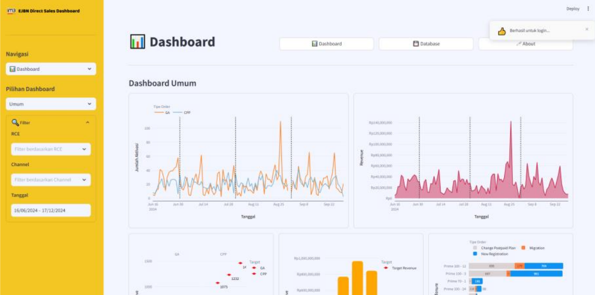

<div align="center">
  

  <h1>EJBN Direct Sales Dashboard</h1>

  <p>
    <strong>An interactive sales performance monitoring dashboard built for PT Indosat Tbk's EJBN division.</strong><br/>
    Tracks daily activations, agent & RCE performance, and revenue metrics — all in real time.
  </p>

  <p>
    
    
    
    
    
  </p>
</div>

---

## 📌 Overview

**EJBN Direct Sales Dashboard** is a web-based internal analytics tool developed during an MBKM (Magang & Studi Independen Bersertifikat) internship at **PT Indosat Tbk**. The dashboard provides sales team leaders and management with a centralized view of direct sales activity, helping them monitor performance, identify trends, and make data-driven decisions.

> **Note:** This dashboard is intended for internal use and requires authorized credentials to access.

---

## ✨ Features

- 🔐 **Secure Login** — Credential-based authentication system to protect internal data
- 📊 **Sales Performance Dashboard** — Real-time visualization of daily activations, order types, and revenue
- 👥 **Agent & RCE Management** — View, add, and edit agent and RCE (Retail Channel Executive) records
- 📈 **Comparative Analysis** — Side-by-side RCE performance comparison with configurable filters
- 🗄️ **Database Integration** — Live connection to a MySQL database with cached queries for efficiency
- 📁 **Excel Export Support** — Export data to `.xlsx` format via openpyxl integration

---

## 🏗️ Project Structure

```
EJBN-Direct_Sales-Dashboard/
├── main.py                  # App entry point & authentication
├── requirements.txt         # Python dependencies
├── pages/
│   ├── dashboard.py         # Main sales performance dashboard
│   ├── database.py          # Database management interface
│   └── about.py             # About page
├── modules/
│   ├── database.py          # DB connection & SQL query handlers
│   ├── visualization.py     # Plotly chart components
│   ├── preprocessing_data.py# Data cleaning & transformation
│   ├── filter.py            # Dashboard filter components
│   ├── page_init.py         # Page layout initialization
│   ├── login_state.py       # Session & login state management
│   └── __init__.py          # Module exports
├── db_scripts/
│   ├── Initialization.sql   # Database schema setup
│   ├── Insert.sql           # Seed data scripts
│   ├── Select.sql           # Common query references
│   └── BackUp.sql           # Database backup script
├── images/                  # Logo & branding assets
├── .streamlit/
│   └── config.toml          # Streamlit theme & server config
└── testing/                 # Jupyter notebooks for EDA & prototyping
```

---

## 🛠️ Tech Stack

| Category         | Technology                  |
|------------------|-----------------------------|
| Frontend / UI    | Streamlit 1.40.0            |
| Visualization    | Plotly 5.24.1               |
| Data Processing  | Pandas ≥ 2.0                |
| Database         | MySQL (via mysql-connector-python 9.1.0) |
| Excel I/O        | openpyxl 3.1.5              |
| Language         | Python 3.11+                |

---

## 🚀 Getting Started

### Prerequisites

- Python **3.11** or higher
- A running **MySQL** instance with the schema initialized (see `db_scripts/Initialization.sql`)
- Streamlit **secrets** configured (see [Configuration](#️-configuration) below)

### Installation

1. **Clone the repository**

   ```bash
   git clone https://github.com/Daffin-TW/EJBN-Direct_Sales-Dashboard.git
   cd EJBN-Direct_Sales-Dashboard
   ```

2. **Create and activate a virtual environment** *(recommended)*

   ```bash
   python -m venv .venv
   # Windows
   .venv\Scripts\activate
   # macOS / Linux
   source .venv/bin/activate
   ```

3. **Install dependencies**

   ```bash
   pip install -r requirements.txt
   ```

4. **Configure secrets** (see below), then **run the app**

   ```bash
   streamlit run main.py
   ```

   The app will be available at `http://localhost:8501`.

---

## ⚙️ Configuration

Create a `.streamlit/secrets.toml` file in the project root with the following structure:

```toml
# Database credentials
[db_credentials]
host     = "your-db-host"
port     = 3306
username = "your-db-user"
password = "your-db-password"
database = "your-db-name"
charset  = "utf8mb4"

# Application user credentials
[[user_credentials]]
username = "admin"
password = "your-secure-password"
```

> ⚠️ **Never commit `secrets.toml` to version control.** It is already listed in `.gitignore`.

---

## 📷 Screenshots

### 🏠 Homepage / Login Page



---

## 🤝 Acknowledgements

This project was developed as part of the **MBKM (Magang & Studi Independen Bersertifikat)** program at **PT Indosat Tbk**. Special thanks to the EJBN Direct Sales team for their guidance and support throughout the internship.

---

## 📄 License

This project is licensed under the terms found in the [LICENSE](LICENSE) file.
